<div align="center">


<h1>InsightFlow AI</h1>

<h3>Understand your business. Act on the data.</h3>

<p>
  <b>InsightFlow is an AI business analyst that refuses to invent a number.</b><br />
  Upload a spreadsheet of your orders and find out what changed, where it came from,<br />
  what may explain it, and what to check next — with the evidence behind every figure.
</p>

<p>
  <a href="https://insight-flow-ai-iota.vercel.app"><b>Live app&nbsp;&rarr;</b></a>
  &nbsp;&nbsp;·&nbsp;&nbsp;
  <a href="TECHNICAL_README.md"><b>Technical Documentation</b></a>
  &nbsp;&nbsp;·&nbsp;&nbsp;
  <a href="#quickstart">Quickstart</a>
  &nbsp;&nbsp;·&nbsp;&nbsp;
  <a href="#inside-the-app">Screenshots</a>
  &nbsp;&nbsp;·&nbsp;&nbsp;
  <a href="#what-you-can-do">Features</a>
  &nbsp;&nbsp;·&nbsp;&nbsp;
  <a href="#built-with">Built with</a>
</p>

</div>

<br />

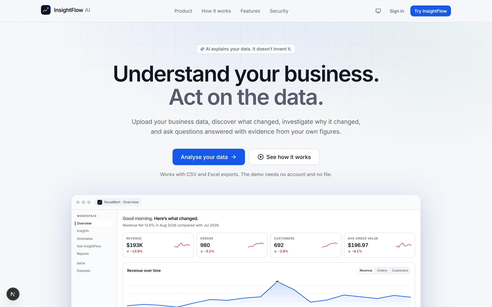

---

## The problem it solves

Most "AI for your data" tools paste a CSV into a language model and ask it for
insights. The answer comes back fluent, confident and quite possibly wrong —
because a language model cannot reliably do arithmetic over fourteen thousand
rows, and a wrong figure looks exactly like a right one on the page.

That is not a rough edge. It is the default behaviour of asking a model to
analyse a spreadsheet, and it is why the output of these tools cannot be acted
on without checking every number by hand.

InsightFlow takes the opposite position: **the engine computes every number, and
the AI is only allowed to phrase them.** Totals, growth rates, contributions and
anomaly bounds come from a deterministic analytics engine. The model writes them
up, and anything it writes that the engine did not compute is thrown away before
you see it.

**Who it is for**

- Small business owners and operators who export orders from Shopify, a POS or
  a spreadsheet and want to know why last month was worse than the one before
- Anyone who has been handed an AI "insight" and had no way to tell whether the
  figure in it was real
- Analysts who want a first pass — what moved, where, and what coincided with
  it — before they open a notebook

**What makes it different**

|                                    |                                                                                                                                                                                         |
| ---------------------------------- | --------------------------------------------------------------------------------------------------------------------------------------------------------------------------------------- |
| **It cannot invent a figure**      | Every number in a generated explanation is checked against the evidence the engine computed. One unmatched figure and the whole response is discarded.                                  |
| **It does not confuse coincidence with cause** | A spreadsheet of orders can only show that two things happened together. Unhedged causal claims — "caused by", "due to", "led to" — are rejected sentence by sentence.   |
| **Every figure can be opened**     | Each answer carries the evidence behind it and the plan that produced it. "View evidence" shows the exact calculation, not a summary of one.                                            |
| **Your rows never reach the model** | The AI receives aggregated metrics, segment names and period labels — never the rows of your file. With a local model, nothing leaves the machine at all.                               |
| **It works with the AI turned off** | Set `AI_ENABLED=false` and every analysis, trend, anomaly, investigation and report still works. The engine writes the explanations itself. The whole test suite runs that way.         |

---

## Quickstart

**Requirements:** Python 3.11+ and Node.js 20+. No database server, no AI key.

```bash
git clone https://github.com/zain-ul-abideen-5036/InsightFlow-AI.git
cd InsightFlow-AI

# Backend
cd backend
python -m venv .venv && source .venv/bin/activate   # Windows: .venv\Scripts\activate
pip install -r requirements.txt -r requirements-dev.txt
cp .env.example .env
uvicorn app.main:app --reload --port 8000           # http://localhost:8000

# Frontend, in a second terminal
cd frontend
npm install
cp .env.example .env.local
npm run dev                                          # http://localhost:3000
```

Open <http://localhost:3000> and click **Explore the live demo** — no account,
no password, no file. Within a few seconds you are looking at a full analysis of
14,000 orders. Development runs on SQLite, and without a model configured the
engine writes every explanation itself. Full setup, every environment variable
and deployment:
**[Technical Documentation →](TECHNICAL_README.md#getting-started)**

---

## Inside the app

Real captures from the running application with the included NovaMart sample
dataset. Every figure in them is one the product produced — nothing here is a
mockup.

### What changed, and what needs attention

Four figures with their shape behind them, the trend, then **what changed** and
**what needs attention** — kept apart, because a movement and an anomaly are
different questions.

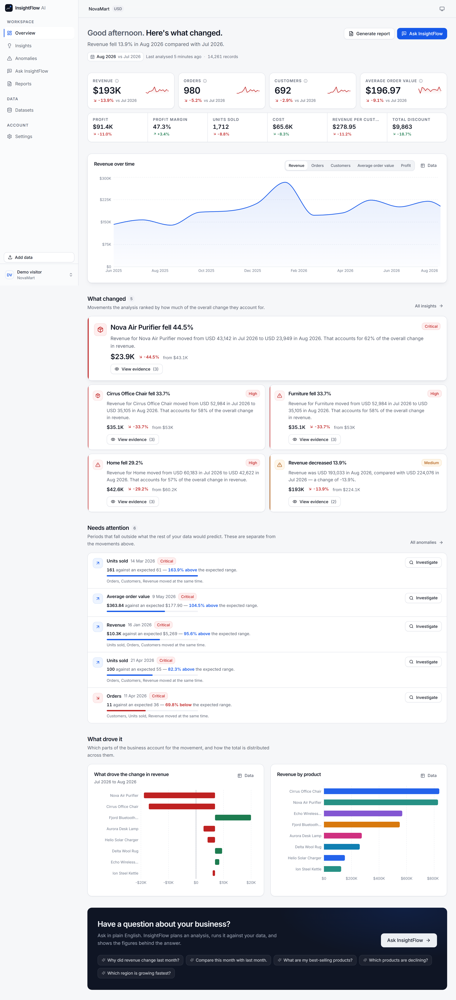

### Ask a question, get the evidence

A business question is turned into a typed analysis plan, run by the engine,
and only then handed to the model to phrase. The conclusion, the figures behind
it, and — set visibly apart, because the distinction is the product — what
*might* explain it.

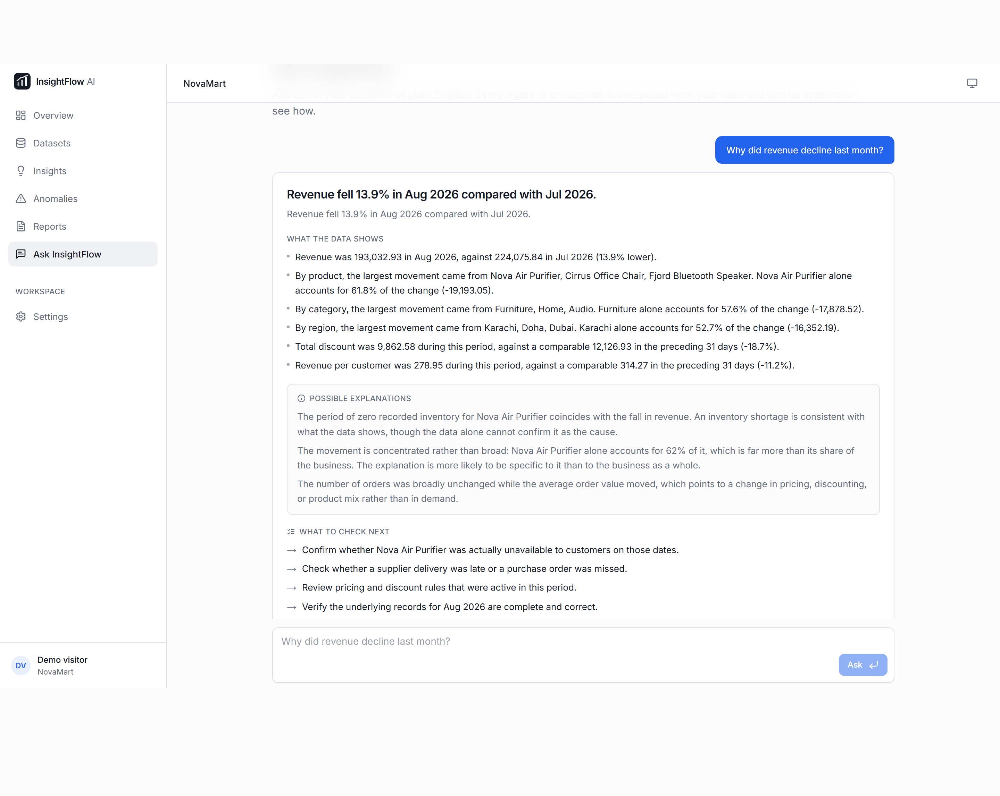

### Upload a file, confirm what it means

<table>
<tr>
<td width="50%">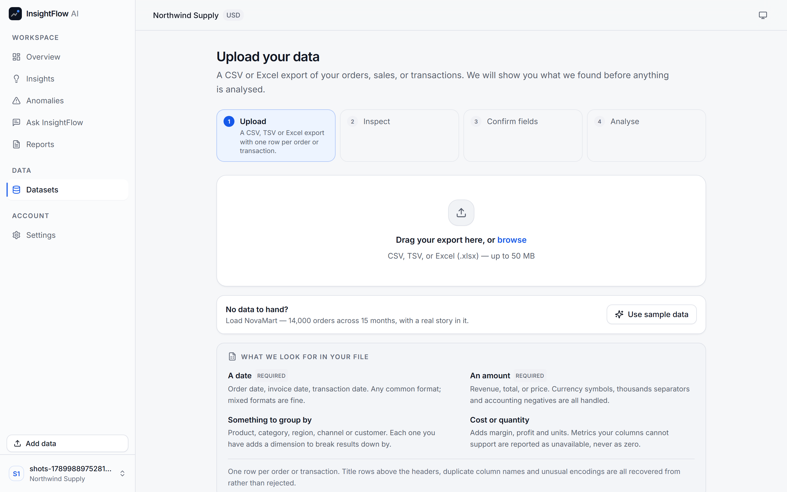</td>
<td width="50%"></td>
</tr>
<tr>
<td align="center"><b>Upload</b> — CSV, TSV or Excel, messy headers and all</td>
<td align="center"><b>Detected fields</b> — what each column was read as, editable before anything runs</td>
</tr>
</table>

### Investigate a movement

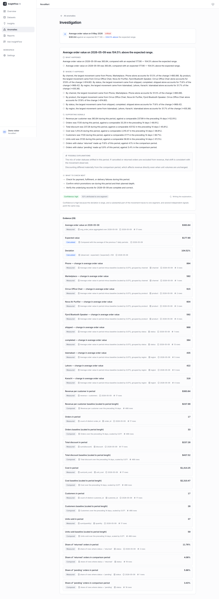

What happened, where it happened, what coincided with it, and what might explain
it. The evidence arrives first and immediately; the written explanation follows,
and is cached so the wait is paid once per anomaly rather than once per visit.

### Findings, anomalies and the report

<table>
<tr>
<td width="50%">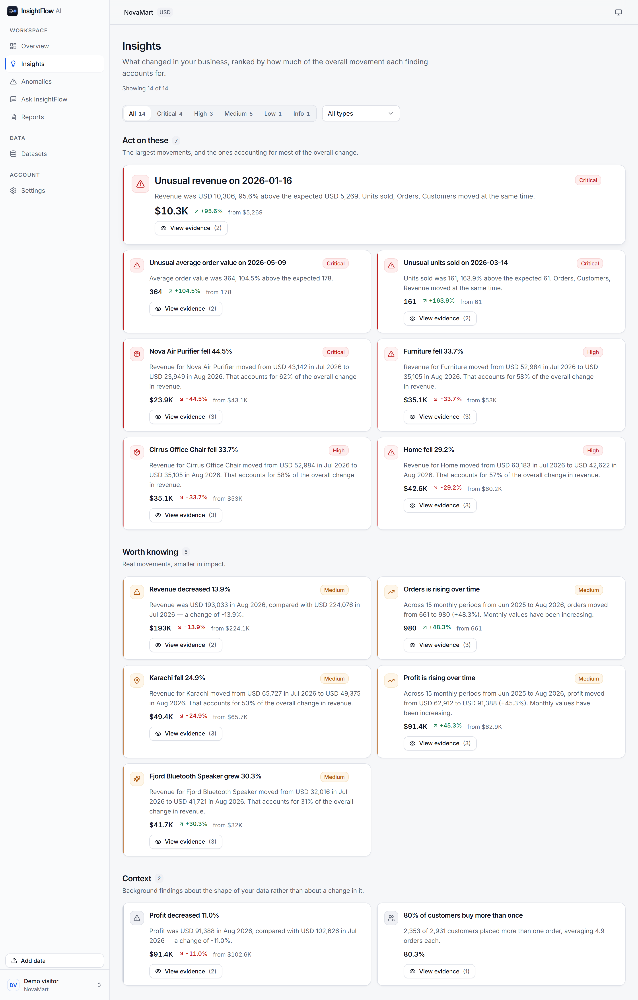</td>
<td width="50%">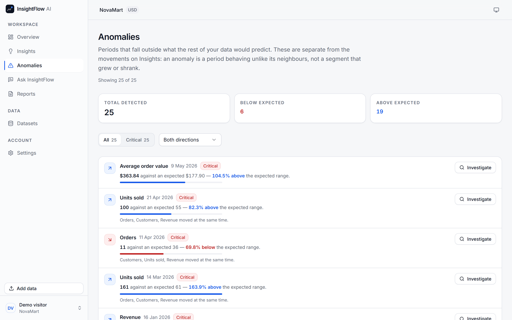</td>
</tr>
<tr>
<td align="center"><b>Insights</b> — findings banded by severity, the top one given prominence</td>
<td align="center"><b>Anomalies</b> — deviation bars, so the one furthest out is visible at a glance</td>
</tr>
<tr>
<td width="50%">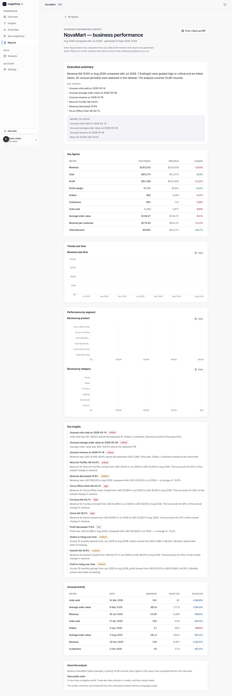</td>
<td width="50%">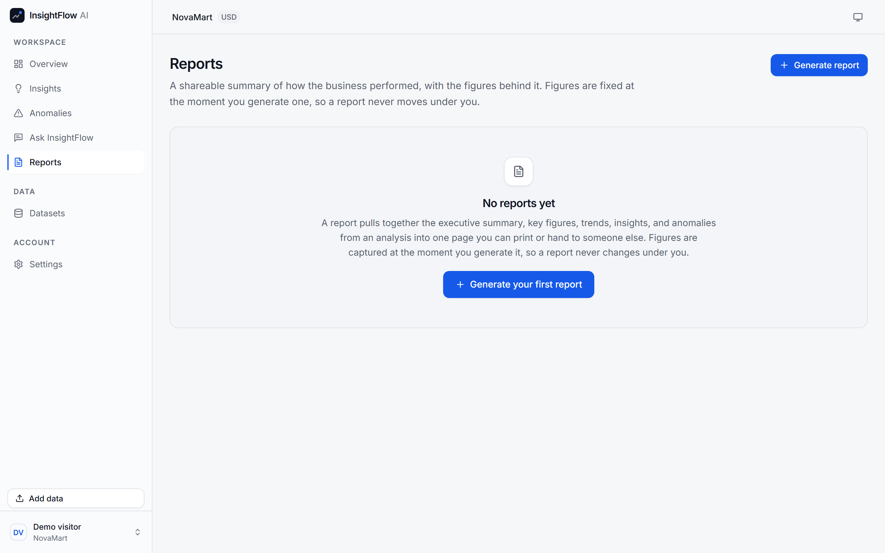</td>
</tr>
<tr>
<td align="center"><b>Report</b> — printable, with its figures fixed at generation time</td>
<td align="center"><b>Reports</b> — every report the workspace has produced</td>
</tr>
</table>

<details>
<summary><b>More of the product</b> — datasets, settings, sign-in, onboarding and the empty Ask screen</summary>

<br />

<table>
<tr>
<td width="50%">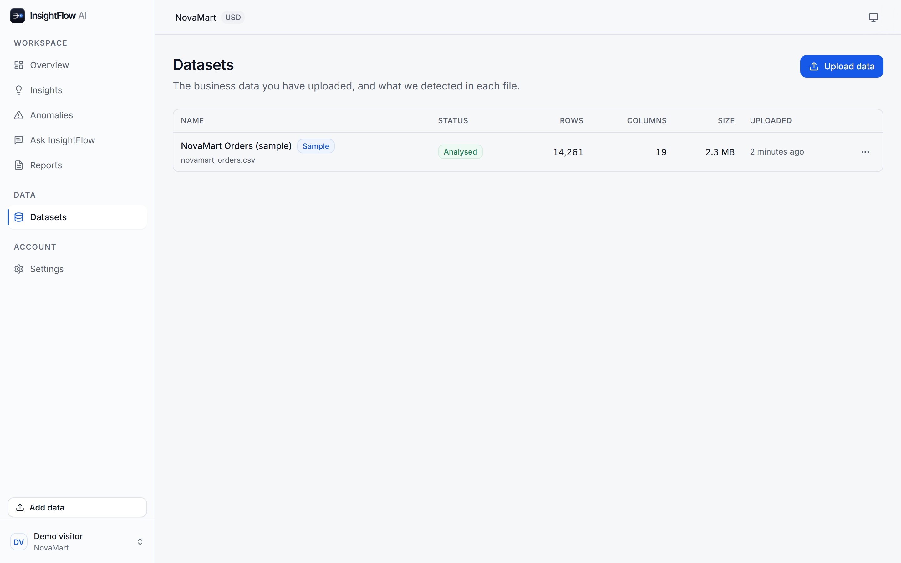</td>
<td width="50%">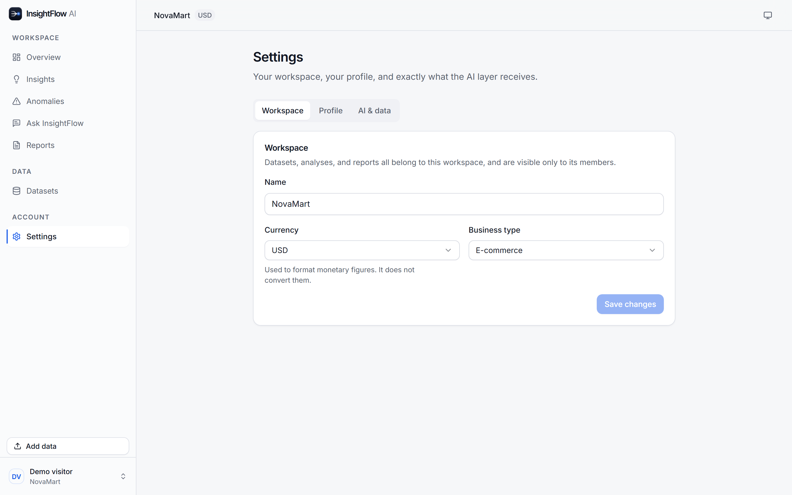</td>
</tr>
<tr>
<td align="center"><b>Datasets</b> — every upload and where its analysis stands</td>
<td align="center"><b>Settings</b> — the active AI provider, and exactly what is sent to it</td>
</tr>
<tr>
<td width="50%">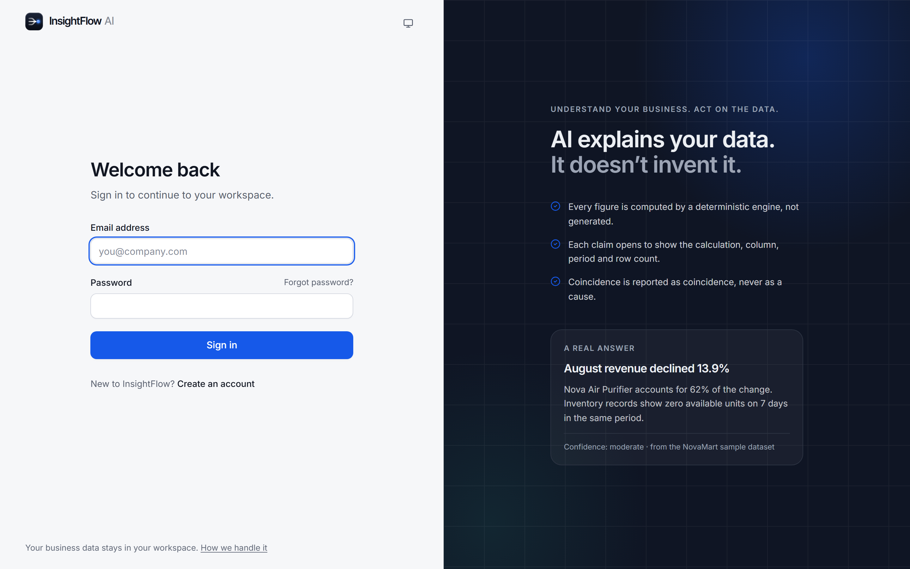</td>
<td width="50%">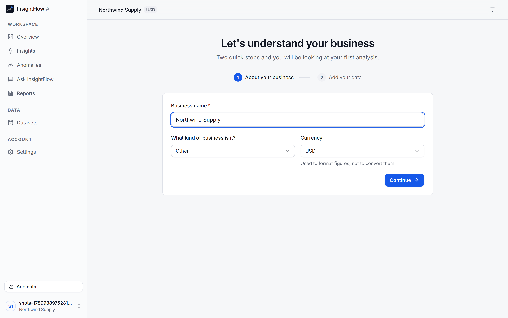</td>
</tr>
<tr>
<td align="center"><b>Sign in</b> — email and password, no third-party identity provider</td>
<td align="center"><b>Onboarding</b> — your own file, or the sample data to explore first</td>
</tr>
</table>

**Ask, before the first question**, with suggestions this dataset can actually
answer.

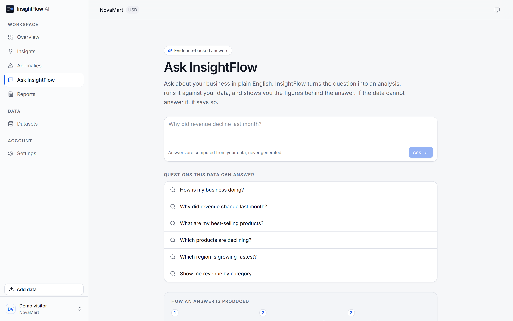

</details>

---

### Two themes, tuned separately

Light and dark are written as two sets of tokens rather than one inverted into
the other, so a red decline and a green gain stay legible instead of turning
muddy.

<table>
<tr>
<td width="50%"></td>
<td width="50%">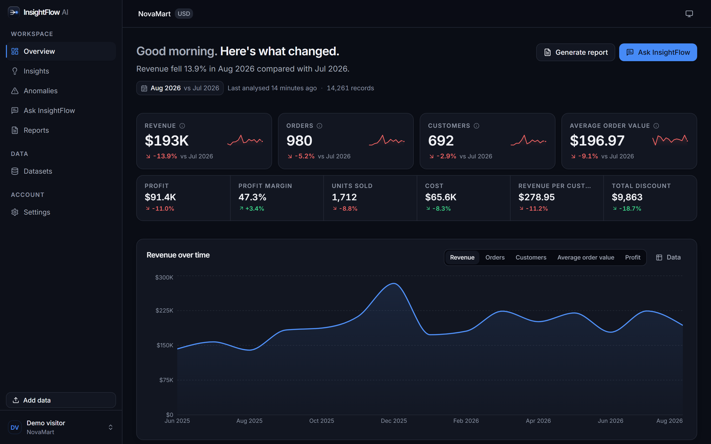</td>
</tr>
</table>

### Built for a phone, not shrunk onto one

<table>
<tr>
<td width="25%">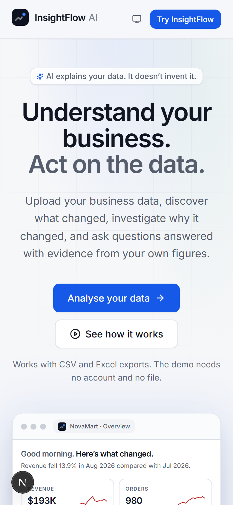</td>
<td width="25%">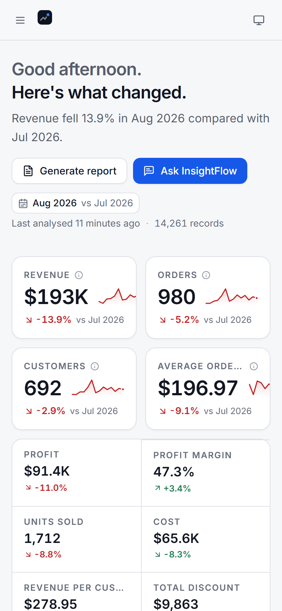</td>
<td width="25%">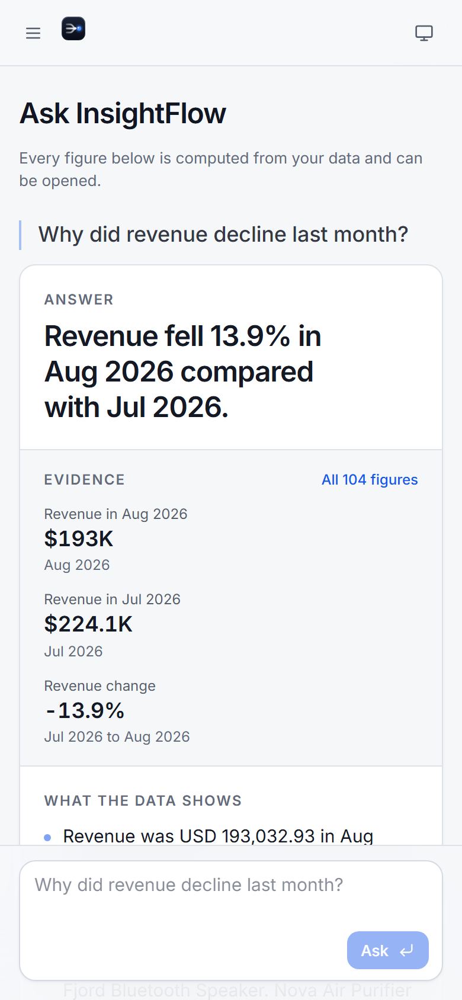</td>
<td width="25%">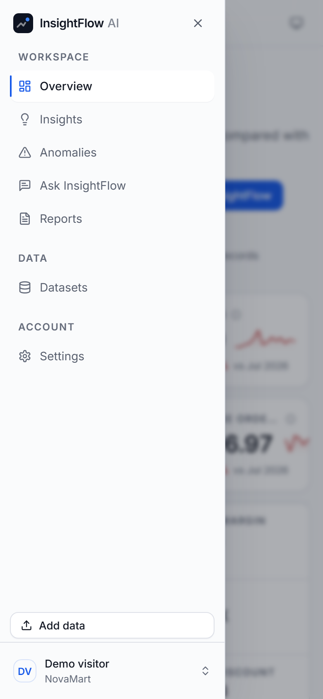</td>
</tr>
</table>

---

## What you can do

<table>
<tr>
<td width="33%" valign="top">

**Upload a real export**

CSV, TSV and Excel, with encoding and delimiter detection, title-row skipping,
duplicate-header recovery, and currency and accounting number parsing — the
things real exports get wrong.

</td>
<td width="33%" valign="top">

**Let it read your columns**

Each column is classified into a role — date, revenue, product, region — from
its name and its values together. You review and correct the result before
anything is analysed.

</td>
<td width="33%" valign="top">

**Get the metrics that apply**

Revenue, cost, profit, margin, orders, customers, units, average order value
and discounting — each produced **only** when the data supports it. A missing
column yields a stated reason, never a zero.

</td>
</tr>
<tr>
<td width="33%" valign="top">

**See the trend**

Daily, weekly, monthly and quarterly, with moving averages, growth tables,
trend detection, and seasonality only when there is enough history to justify
the claim.

</td>
<td width="33%" valign="top">

**Catch what is unusual**

Rolling z-score, interquartile range and Isolation Forest, each applied where it
fits. One business event produces one anomaly, with the other metrics it moved
listed as corroboration.

</td>
<td width="33%" valign="top">

**Find out where it came from**

A movement is attributed across every dimension and ranked by *excess*
contribution — how much a segment moved relative to its size — alongside
stockouts and status shifts that coincided with it.

</td>
</tr>
<tr>
<td width="33%" valign="top">

**Ask in plain English**

"Why did revenue fall last month?" becomes an analysis plan, run by the engine.
Every answer carries its plan, its evidence, and follow-ups the dataset can
actually answer.

</td>
<td width="33%" valign="top">

**Share a report**

A printable performance report whose sections are fixed when it is generated,
so a report never silently changes its own figures after it has been sent.

</td>
<td width="33%" valign="top">

**Try it with no file**

The public demo creates a private, throwaway workspace with a full sample
analysis already loaded. No account, no password, no shared login — and it is
deleted automatically.

</td>
</tr>
</table>

---

## How it works

<table>
<tr>
<td width="20%" valign="top" align="center"><b>01</b><br /><br /><b>Data</b><br /><sub>Your file is parsed, profiled, and its columns given meaning — which you confirm.</sub></td>
<td width="20%" valign="top" align="center"><b>02</b><br /><br /><b>Analysis</b><br /><sub>The engine computes metrics, trends, segments and anomalies in pandas. Tested against known answers.</sub></td>
<td width="20%" valign="top" align="center"><b>03</b><br /><br /><b>Insight</b><br /><sub>Findings are ranked, and each carries the evidence and the named calculation behind it.</sub></td>
<td width="20%" valign="top" align="center"><b>04</b><br /><br /><b>Explanation</b><br /><sub>The model phrases the findings. What it writes is checked against the evidence before you see it.</sub></td>
<td width="20%" valign="top" align="center"><b>05</b><br /><br /><b>Action</b><br /><sub>What to check next — hedged as a hypothesis, never stated as a cause the data cannot prove.</sub></td>
</tr>
</table>

---

## The part that matters

Prompts ask a model to behave. They do not make it behave. So the rule that
InsightFlow will not invent a figure is not written in a prompt — it is a
validator that runs on the model's output, and it discards anything it cannot
trace back to the computed evidence.

Here is real output from the sample dataset:

> **Revenue fell 13.9% in Aug 2026 compared with Jul 2026.**
>
> By product, the largest movement came from Nova Air Purifier. It alone
> accounts for 61.8% of the change (−$19,193).
>
> Inventory records show zero available units on 7 days in this period.
>
> *Possible explanation:* the period of zero recorded inventory for Nova Air
> Purifier coincides with the fall in revenue. An inventory shortage is
> consistent with what the data shows, though the data alone cannot confirm it
> as the cause.
>
> **Confidence:** moderate · [View evidence]

Note what it does *not* say: that the stockout **caused** the decline.
Co-occurrence is all the data establishes, so co-occurrence is all the product
is allowed to claim.

| Check                    | What it rejects                                                                                                  |
| ------------------------ | ---------------------------------------------------------------------------------------------------------------- |
| **Figures**              | Any number in the text that the engine did not compute — allowing only rounding, differences and downward rescaling |
| **Rescaling**            | `100` in the evidence licensing `100,000` in the text. Only downward rescaling is permitted                         |
| **Dates**                | Nothing — dates are stripped first, so `2026-03-14` is never misread as the figures `-03` and `-14`                 |
| **Causal claims**        | `caused by`, `due to`, `led to`, `drove the` — unless the *same sentence* hedges it                                 |
| **Malformed output**     | Invalid JSON or a response that does not match the schema, after one repair attempt                               |
| **A failed provider**    | Nothing reaches the user as an error. Every failure falls back to the engine's own written answer                   |

The adversarial test suite attacks this directly: questions the data cannot
answer, leading questions pushing for a cause, fabricated dates and columns —
and a sweep of 27 questions at four time grains asserting that *every figure the
engine writes is one it recorded*. That sweep found three real defects. The
source is [`backend/app/ai/guardrails.py`](backend/app/ai/guardrails.py), and the
full account is in [AI guardrails](docs/AI_GUARDRAILS.md).

---

## Built with

<div align="center">

<h4>Frontend</h4>

<table>
<tr>
<td align="center" width="118"><br /><sub><b>Next.js</b><br />15.5</sub></td>
<td align="center" width="118"><br /><sub><b>React</b><br />19</sub></td>
<td align="center" width="118"><br /><sub><b>TypeScript</b><br />5.7 strict</sub></td>
<td align="center" width="118"><br /><sub><b>Tailwind CSS</b><br />3.4</sub></td>
</tr>
<tr>
<td align="center" width="118"><br /><sub><b>Radix UI</b><br />primitives</sub></td>
<td align="center" width="118"><br /><sub><b>TanStack Query</b><br />5</sub></td>
<td align="center" width="118"><br /><sub><b>Zod</b><br />3</sub></td>
<td align="center" width="118"><br /><sub><b>Lucide</b><br />icons</sub></td>
</tr>
</table>

<h4>Backend and analytics</h4>

<table>
<tr>
<td align="center" width="118"><br /><sub><b>Python</b><br />3.12</sub></td>
<td align="center" width="118"><br /><sub><b>FastAPI</b><br />0.115</sub></td>
<td align="center" width="118"><br /><sub><b>Pydantic</b><br />2.10</sub></td>
<td align="center" width="118"><br /><sub><b>JWT</b><br />via PyJWT</sub></td>
</tr>
<tr>
<td align="center" width="118"><br /><sub><b>pandas</b><br />2.2</sub></td>
<td align="center" width="118"><br /><sub><b>NumPy</b><br />2.2</sub></td>
<td align="center" width="118"><br /><sub><b>scikit-learn</b><br />1.6</sub></td>
<td align="center" width="118"><br /><sub><b>Ollama</b><br />local models</sub></td>
</tr>
</table>

<h4>Data</h4>

<table>
<tr>
<td align="center" width="118"><br /><sub><b>PostgreSQL</b><br />production</sub></td>
<td align="center" width="118"><br /><sub><b>SQLAlchemy</b><br />2.0 + Alembic</sub></td>
<td align="center" width="118"><br /><sub><b>Neon</b><br />hosted Postgres</sub></td>
<td align="center" width="118"><br /><sub><b>Docker</b><br />self-hosting</sub></td>
</tr>
</table>

<h4>Testing and delivery</h4>

<table>
<tr>
<td align="center" width="118"><br /><sub><b>pytest</b><br />299 tests</sub></td>
<td align="center" width="118"><br /><sub><b>Vitest</b><br />4</sub></td>
<td align="center" width="118"><br /><sub><b>ESLint</b><br />9</sub></td>
<td align="center" width="118"><br /><sub><b>Vercel</b><br />deployment</sub></td>
<td align="center" width="118"><br /><sub><b>GitHub Actions</b><br />CI</sub></td>
</tr>
</table>

</div>

Also in use, and carrying a good deal of the weight, but without a brand mark of
their own: **Recharts** draws every chart, each wrapped to ship a text summary
and a data table; **React Hook Form** runs the forms; **Playwright** drives the
end-to-end journey and captures these screenshots; **Groq** serves the model on
the live instance through its OpenAI-compatible API; **openpyxl** and
**charset-normalizer** read Excel files and detect encodings; **pyarrow** keeps
an optional Parquet cache; **bcrypt** hashes passwords; and **gitleaks** scans
every push for secrets.

The full breakdown, with the role each one plays, is in the
[technical documentation](TECHNICAL_README.md#technology-stack).

---

## Where it is useful

- **Explaining a bad month.** The whole product is built around one question —
  what changed, and where did it come from — which is the one a business owner
  actually asks.
- **Catching what you were not looking for.** A stockout, a cancellation spike
  or a region quietly eroding shows up as an anomaly before it shows up in the
  bank balance.
- **Knowing what to check next.** Every investigation ends in concrete checks —
  was the product purchasable, was a delivery late — rather than a conclusion
  the data cannot support.
- **As a reference implementation.** A full-stack Next.js and FastAPI
  application with real authentication, tenant isolation, a deterministic
  engine under known-answer tests, an LLM layer with output validation, and a
  free serverless deployment.

InsightFlow describes what your data shows. It does not forecast, it does not
give financial advice, and it cannot tell you *why* something happened — only
what coincided with it.

---

## Project highlights

|                                        |                                                                                                                                                                                                                  |
| -------------------------------------- | ---------------------------------------------------------------------------------------------------------------------------------------------------------------------------------------------------------------- |
| **A guarantee, not a prompt**          | The no-invented-figures rule is a validator over model output, not an instruction to the model. An adversarial suite feeds it exactly what a misbehaving model would produce.                                    |
| **Figures that cannot drift**          | Every number comes from the engine, so the same file always produces the same figures. Reports materialise their sections at generation time and never change after they are sent.                               |
| **Arithmetic under test**              | Known datasets with hand-verified answers — January 1,000 to February 1,200 must return exactly 20%. A weekly-grain bug that silently zeroed every figure is now pinned by a test that every grain preserves the total.                         |
| **Authorization by construction**      | Every workspace resource is probed in tests with a *valid* id from another tenant. Cross-tenant reads answer 404, never 403 — a 403 would confirm the id exists.                                                  |
| **It degrades honestly**               | A dead provider, a timeout or malformed JSON all fall back to the engine's own answer, and the interface says which one you are reading: "Written from the computed analysis" or "Explained by *model*".        |
| **Tested where it matters**            | 299 backend tests, 80 frontend tests, 11 browser end-to-end tests, and a full-stack acceptance script that drives the product through the Next.js layer with a real session cookie.                              |
| **Free to run, end to end**            | One Vercel project for both services and one Neon database, with no credit card. The backend has no public address; the frontend reaches it through a service binding.                                           |

---

## Documentation

Complete engineering detail — architecture, setup, environment variables,
testing, security and deployment — starts in one place:

<div align="center">

### [Technical Documentation &rarr;](TECHNICAL_README.md)

</div>

| Looking for                        | Go to                                                               |
| ---------------------------------- | ------------------------------------------------------------------- |
| Running it locally                 | [Getting started](TECHNICAL_README.md#getting-started)              |
| Every environment variable         | [Environment](docs/ENVIRONMENT.md)                                  |
| How the layers fit together        | [Architecture](docs/ARCHITECTURE.md)                                |
| How invented figures are prevented | [AI guardrails](docs/AI_GUARDRAILS.md)                              |
| What the test suites prove         | [Testing](docs/TESTING.md)                                          |
| Putting it online, step by step    | [Go live](docs/GO_LIVE.md)                                          |
| Docker and self-hosting            | [Deployment](docs/DEPLOYMENT.md)                                    |
| Security posture                   | [Security](docs/SECURITY.md)                                        |
| The sample dataset and demo modes  | [Demo](docs/DEMO.md)                                                |
| The interface's tokens and rules   | [Design system](docs/DESIGN_SYSTEM.md)                              |
| Where it stands, and what is not built | [Final launch report](docs/FINAL_LAUNCH_REPORT.md)              |

---

## Project status

Deployed and running at
**[insight-flow-ai-iota.vercel.app](https://insight-flow-ai-iota.vercel.app)** —
one Vercel project serving the Next.js frontend and the FastAPI backend, with
Neon PostgreSQL. The health endpoint reports the database as reachable and the
AI provider (Groq, `openai/gpt-oss-120b`) as available.

- 299 backend tests passing, covering analytical correctness, tenant isolation,
  AI safety and adversarial attacks
- 80 frontend tests, with typecheck and lint clean under `npm run check`
- 11 end-to-end tests of the full browser journey in Chromium
- Migrations version-controlled and applied on every deploy, failing the deploy
  if they fail
- CI runs on every push: both test suites, a production build, a check that the
  models and migrations agree, the full-stack acceptance script, the browser
  end-to-end tests, and a gitleaks secret scan

Known gaps, stated plainly:

- **Uploads on the live instance are capped at 4 MB.** A Vercel Function rejects
  request bodies over 4.5 MB before the application runs. Self-hosted, the
  limit is 50 MB.
- **The live instance sends aggregates to Groq.** Never the rows of your file,
  but aggregated metrics and segment names do leave for a hosted model. Run it
  locally with Ollama and nothing leaves the machine.
- **Password reset issues a token that nothing delivers.** There is no
  transactional email yet. The demo needs no account, so it is unaffected.
- **Rate limiting is per process.** It will not hold across horizontally scaled
  instances until it moves to a shared store.
- **The guardrails are numeric and causal.** A non-numeric misstatement, or a
  hallucinated segment name, would not be caught by them — documented in
  [AI guardrails](docs/AI_GUARDRAILS.md).
- **No compliance certification is held** — no SOC 2, ISO 27001, HIPAA or GDPR.
  The controls in [Security](docs/SECURITY.md) are the ones that exist.

---

<div align="center">


**InsightFlow AI** — an AI business analyst that shows its working

Built by [Zain Ul Abideen](https://github.com/zain-ul-abideen-5036)

[Repository](https://github.com/zain-ul-abideen-5036/InsightFlow-AI)
&nbsp;·&nbsp;
[Technical Documentation](TECHNICAL_README.md)
&nbsp;·&nbsp;
[MIT Licence](LICENSE)

<br />

<sub><i>The AI may explain the evidence. It may not add to it.</i></sub>

</div>
